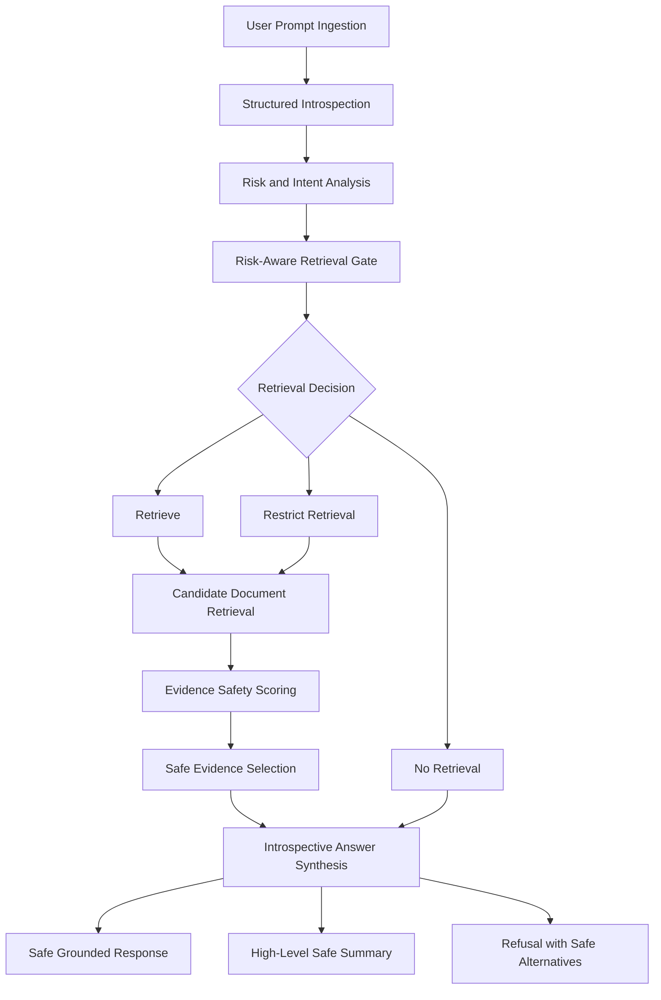

# Risk-Aware Introspective RAG (RAI-RAG)

<p align="center">

[](https://medium.com/@miraj.ai/risk-aware-introspective-rag-building-safety-aligned-retrieval-systems-for-trustworthy-ai-6be3738d2a6c)


</p>

**Risk-Aware Introspective RAG (RAI-RAG)** is a research framework for developing safety-aligned Retrieval-Augmented Generation (RAG) systems. It treats retrieval as a safety-critical decision rather than a neutral preprocessing operation.

RAI-RAG integrates structured introspective reasoning, risk-aware retrieval gating, evidence-level safety alignment, Safety-Informed Monte Carlo Tree Search (SI-MCTS), and meta-learned safety adaptation to control whether external knowledge should be retrieved, which evidence should be retained, and how retrieved information influences final generation.

---
> [!CAUTION] 
> $\color{red}{\textsf{\textbf{⚠ Warning: Harmful or offensive content may be present for research and educational purposes only.}}}$
---

## Table of Contents

- [1. Overview](#1-overview)
- [2. Research Motivation](#2-research-motivation)
- [3. Core Research Problem](#3-core-research-problem)
- [4. Key Features](#4-key-features)
- [5. Mathematical Formulation](#5-mathematical-formulation)
- [6. High-Level Architecture](#6-high-level-architecture)
- [7. System Components](#7-system-components)
- [8. Execution Flow](#8-execution-flow)
- [9. Safety-Informed MCTS](#9-safety-informed-mcts)
- [10. Meta-Learned Safety Adaptation](#10-meta-learned-safety-adaptation)
- [11. Repository Structure](#11-repository-structure)
- [12. Installation](#12-installation)
- [13. Configuration](#13-configuration)
- [14. Experimental Evaluation](#14-experimental-evaluation)
- [15. Research Scope and Limitations](#15-research-scope-and-limitations)
- [16. Future Research Directions](#16-future-research-directions)
- [17. License and Usage Restrictions](#17-license-and-usage-restrictions)


## 1. Overview

Retrieval-Augmented Generation (RAG) enhances Large Language Models (LLMs) by retrieving external knowledge and incorporating relevant evidence into the generation process.

However, conventional RAG architectures primarily optimize retrieval relevance and answer quality. They do not necessarily establish whether retrieving or using a particular document is safe.

A language model may be aligned at generation time and still produce grounded but unsafe responses if the retrieval system supplies harmful, adversarial, or policy-violating evidence.

RAI-RAG addresses this problem by introducing safety considerations throughout the retrieval and generation pipeline.

### Core Research Insight

> A language model can be aligned at generation time and still produce grounded but unsafe outputs if retrieval supplies unsafe evidence.
>
> **RAI-RAG aligns evidence access, not only output.**

Unlike conventional RAG systems that retrieve documents unconditionally, RAI-RAG makes retrieval an explicit decision governed by structured introspective reasoning and safety policies.

### Research Focus

- Structured Introspective Reasoning.
- Risk-Aware Retrieval Gating.
- Evidence-Level Safety Alignment.
- Safety-Informed Monte Carlo Tree Search (SI-MCTS).
- Meta-Learned Safety Adaptation.
- Trustworthy Retrieval-Augmented Generation.


## 2. Research Motivation

Conventional RAG systems generally follow this workflow:

1. Receive a user query.
2. Retrieve relevant documents.
3. Pass retrieved documents to the LLM.
4. Generate an answer based on the retrieved evidence.

Although this architecture improves factual grounding, it introduces additional security risks.

For example:

- A malicious query may retrieve harmful procedural information.
- Retrieved documents may contain adversarial instructions.
- Relevant documents may still contain unsafe content.
- Retrieved evidence may manipulate the model's reasoning.
- A grounded response may violate applicable safety policies.

These issues demonstrate that retrieval relevance and evidence safety are different objectives. A document can be highly relevant to a query while still being unsafe to use.

### Research Questions

RAI-RAG investigates the following questions:

1. How can an LLM determine whether external retrieval is necessary before accessing external knowledge?
2. How can retrieval decisions adapt to the safety risk and intent of a user query?
3. How can retrieved documents be evaluated for safety independently of their relevance?
4. How can unsafe evidence be filtered before it influences generation?
5. How can search over reasoning and retrieval trajectories improve safety?
6. How can safety behavior generalize across different jailbreak task families and distribution shifts?


## 3. Core Research Problem

The central problem addressed by RAI-RAG is the lack of explicit safety control over evidence retrieval and utilization in conventional RAG systems.

Traditional RAG emphasizes:

- Retrieval relevance.
- Semantic similarity.
- Context quality.
- Answer accuracy.

RAI-RAG additionally considers:

- User intent.
- Safety risk.
- Retrieval necessity.
- Evidence safety.
- Policy compliance.
- Safety-aware reasoning trajectories.

The framework treats retrieval as a decision that must be justified before external knowledge is accessed.

### Central Design Principle

**Retrieval should not be automatic. It should be conditional on the safety assessment of the request and the necessity of external evidence.**

RAI-RAG therefore introduces three retrieval decisions:

| Decision | Description |
|---|---|
| Retrieve | Perform normal retrieval when the request is sufficiently safe and external evidence is necessary. |
| Restrict | Perform retrieval under additional safety constraints. |
| No-Retrieve | Skip external retrieval when retrieval is unnecessary or would amplify harmful content. |

---

## 4. Key Features

### 4.1 Structured Introspective Reasoning

RAI-RAG introduces structured reasoning steps to assess user intent, safety risks, and retrieval requirements before retrieving external knowledge.

Key capabilities:

- Explicit structured reasoning representation.
- Intent and risk assessment.
- Retrieval necessity analysis.
- Separation between reasoning representation and final output.
- Refusal and safety constraints.

The intended output format separates reasoning and final response:

```text
<Reasoning_step>
Intent and risk assessment.
Retrieval necessity analysis.
Applicable safety constraints.
</Reasoning_step>

<Output>
Final user-facing response.
</Output>
```

### 4.2 Risk-Aware Retrieval Gating

RAI-RAG dynamically selects one of three retrieval actions:

- Retrieve.
- Restrict.
- No-Retrieve.

Restricted retrieval can incorporate:

- Trusted-domain allowlists.
- Time-window constraints.
- Reduced retrieval depth (`top_k`).
- Safety-aware query rewriting.
- Restrictions on expected evidence types.

### 4.3 Evidence-Level Safety Alignment

Retrieved documents are evaluated independently of their relevance.

The evidence safety module:

- Assigns safety scores to candidate documents.
- Identifies potentially harmful evidence.
- Filters documents with negative safety scores.
- Maintains document provenance.
- Supports fallback strategies when insufficient safe evidence remains.

This aims to mitigate retrieval-driven jailbreaks and grounded harmful generation.

### 4.4 Safety-Informed Monte Carlo Tree Search (SI-MCTS)

RAI-RAG incorporates safety-informed search over reasoning and retrieval trajectories.

The intended search process includes:

- Exploration of alternative reasoning trajectories.
- Evaluation of retrieval decisions.
- Safety-dominant trajectory selection.
- Safety-aware pruning.
- Backpropagation of evaluation signals.

### 4.5 Meta-Learned Safety Adaptation

RAI-RAG incorporates a dual-loop learning design intended to improve safety adaptation across different jailbreak task families.

The research direction focuses on:

- Task-family sampling.
- Safety-oriented adaptation.
- Generalization across different attack patterns.
- Robustness under distribution shift.
- Adaptation to previously unseen attack variations.

### 4.6 Modular and Reproducible Design

The architecture separates:

- Reasoning.
- Retrieval.
- Evidence evaluation.
- Safety assessment.
- Search.
- Reward modeling.
- Meta-learning.
- Evaluation.

The intended modularity allows different LLM backbones, retrievers, safety judges, and search strategies to be evaluated independently.


## 5. Mathematical Formulation

This section presents the mathematical notation used in the RAI-RAG architecture.

**Important:** All display equations use GitHub-compatible LaTeX delimiters. The opening and closing `$$` must each occupy their own line in the actual README.

### 5.1 Input Representation

Let the user query be represented by:

$$
x \in \mathcal{X}
$$

Where:

- $x$: User input.
- $\mathcal{X}$: Input space.

The system analyzes the query before making a retrieval decision.

### 5.2 Introspective Reasoning

The structured introspective reasoning process produces:

$$
y_{\mathrm{IR}} = (s_1,s_2,\ldots,s_n,f)
$$

Where:

- $y_{\mathrm{IR}}$: Introspective reasoning representation.
- $s_i$: An intermediate reasoning step.
- $n$: Number of reasoning steps.
- $f$: Final output representation.

The reasoning representation is used to derive a structured safety and retrieval state.

### 5.3 Risk-Aware Retrieval Decision

The retrieval controller selects one action from the following set:

$$
a_{\mathrm{RAG}} \in
\{
\mathrm{Retrieve},
\mathrm{Restrict},
\mathrm{NoRetrieve}
\}
$$

The decision is conditioned on the input and introspective reasoning:

$$
a_{\mathrm{RAG}} =
\pi_{\mathrm{RAG}}(x,y_{\mathrm{IR}})
$$

Where:

- $\pi_{\mathrm{RAG}}$: Risk-aware retrieval policy.
- $x$: User query.
- $y_{\mathrm{IR}}$: Introspective reasoning representation.
- $a_{\mathrm{RAG}}$: Selected retrieval action.

### 5.4 Retrieved Document Representation

Let the retrieved candidate document collection be:

$$
D = \{d_1,d_2,\ldots,d_m\}
$$

Where:

- $D$: Candidate document collection.
- $d_i$: Individual retrieved document.
- $m$: Number of retrieved documents.

### 5.5 Evidence-Level Safety Scoring

Each retrieved document is evaluated using an evidence safety function:

$$
s_i =
S_e(d_i \mid x,y_{\mathrm{IR}})
$$

The safety score is defined within the following range:

$$
s_i \in [-1,1]
$$

Where:

- $S_e$: Evidence safety scoring function.
- $d_i$: Retrieved document.
- $x$: Original user query.
- $y_{\mathrm{IR}}$: Introspective reasoning representation.
- $s_i$: Document-level safety score.

Under the described scoring convention:

- Negative scores indicate unsafe or policy-violating evidence.
- Non-negative scores indicate evidence that passes the initial safety threshold.

### 5.6 Safe Evidence Selection

The safe evidence collection is represented as:

$$
D_{\mathrm{safe}} =
\left\{
d_i \in D
\mid
S_e(d_i \mid x,y_{\mathrm{IR}}) \geq 0
\right\}
$$

Where:

- $D_{\mathrm{safe}}$: Retained evidence collection.
- $D$: Original candidate document collection.
- $S_e$: Evidence safety scoring function.

Documents with negative safety scores are excluded from the retained evidence collection.

### 5.7 Composite Reward Function

The RAI-RAG repository architecture includes the following composite reward expression:

$$
R(H,S,I) =
F(S)H + S + \lambda I
$$

Where the symbols are retained from the original research formulation.

The precise operational definitions, score ranges, normalization procedures, and functional form of $F(S)$ and $\lambda$ must be specified in the corresponding reward implementation before this expression is treated as a fully defined optimization objective.

**Important:** This is the documented research formulation, not a claim that a particular reward model has already been trained or validated.


## 6. High-Level Architecture

<p align="center">
  
</p>

RAI-RAG introduces a safety-first RAG pipeline in which evidence access is an explicit, auditable, and optimizable decision.

The architecture consists of five primary stages.



### Architecture Overview

| Stage | Component | Main Responsibility |
|---|---|---|
| 1 | User Prompt Ingestion | Receive, normalize, and log the user query. |
| 2 | Structured Introspection | Analyze user intent, ambiguity, and safety risk. |
| 3 | Retrieval Decision | Select Retrieve, Restrict, or No-Retrieve. |
| 4 | Evidence Safety Selection | Retrieve candidate documents and filter unsafe evidence. |
| 5 | Answer Synthesis | Generate a grounded response under applicable safety constraints. |


## 7. System Components

### 7.1 User Prompt Ingestion

**Input:** User query $x$.

The system receives and normalizes the raw user input.

Possible operations include:

- Basic input normalization.
- Language detection.
- Input logging.
- Basic sanitation.
- Optional personally identifiable information (PII) handling.

At this stage, external retrieval is not performed.

**Output:** A canonicalized prompt representation containing:

- `x.text`
- `x.metadata`

### 7.2 Structured Introspection

The introspection module evaluates the request before retrieval.

Its responsibilities include:

**Intent Inference**

Distinguish benign information requests from potentially harmful or disguised requests.

**Policy Mapping**

Identify applicable safety categories and policy constraints.

**Ambiguity Assessment**

Determine whether the user's intent is unclear or requires conservative handling.

**Retrieval Necessity Analysis**

Determine whether external evidence is required to answer the query.

**Output:**

A validated introspection representation and structured state containing:

- `intent_hypothesis`
- `risk_category`
- `confidence`
- `uncertainty`
- `retrieval_need`

### 7.3 Risk-Aware Retrieval Gate

The retrieval gate receives the introspective state and determines whether external retrieval should proceed.

#### Retrieve

Normal retrieval is permitted when the request is sufficiently safe and external evidence is needed.

#### Restrict

Retrieval proceeds under additional constraints, such as:

- Trusted-source restrictions.
- Limited retrieval depth.
- Query rewriting.
- Domain allowlists.
- Restricted evidence categories.

#### No-Retrieve

External retrieval is skipped when:

- The request is clearly unsafe and retrieval would amplify harm.
- External evidence is unnecessary.
- A safe answer can be provided without additional documents.

**Output:** A retrieval plan containing:

- Selected retrieval action.
- Retrieval constraints.
- Original or rewritten query.
- Expected evidence type.

### 7.4 Safe Evidence Selection

When retrieval is permitted, candidate documents are retrieved using an available retrieval backend.

The intended retrieval options include:

- FAISS.
- BM25.
- Hybrid retrieval.

The retrieved documents are then evaluated by the evidence safety module.

Each document receives a safety score, and documents with negative scores are filtered out under the current scoring convention.

If too many documents are filtered, the system may:

- Apply restricted retrieval.
- Rewrite the retrieval query.
- Generate a safe high-level response without external evidence.

**Output:** A safe evidence collection containing retained documents and provenance information.

### 7.5 Introspective Answer Synthesis

The final generation stage receives:

- Validated introspection representation.
- Safe evidence collection, when available.
- Applicable safety constraints.

The generator can produce three types of outcomes.

**Safe Grounded Response**

Uses retained evidence and avoids prohibited procedural details.

**High-Level Safe Summary**

Provides general, non-actionable information when detailed evidence cannot safely be used.

**Refusal with Safe Alternatives**

Declines requests that cannot be safely fulfilled and provides appropriate alternatives.

Optional test-time selection can evaluate multiple candidate responses using safety and helpfulness signals.


## 8. Execution Flow

The complete execution pipeline can be summarized as follows:

```text
(1) User Prompt
        |
        v
(2) Structured Introspection
        |
        v
(3) Intent and Risk Assessment
        |
        v
(4) Retrieval Gate
        |
        +-----------------------------+
        |              |              |
        v              v              v
     Retrieve       Restrict       No-Retrieve
        |              |
        v              v
(5) Candidate Document Retrieval
        |
        v
(6) Evidence Safety Scoring
        |
        v
(7) Safe Evidence Selection
        |
        v
(8) Introspective Answer Synthesis
        |
        v
(9) Safe Grounded Response,
    High-Level Summary, or Refusal
```

The central design principle is that retrieved knowledge should influence generation only after passing the relevant evidence safety evaluation.


## 9. Safety-Informed MCTS

RAI-RAG incorporates Safety-Informed Monte Carlo Tree Search (SI-MCTS) as a research component for exploring alternative reasoning and retrieval trajectories.

Unlike a retrieval pipeline that commits to one retrieval decision, the search component is intended to evaluate alternative paths.

### 9.1 Search Representation

A search node represents a partial reasoning and retrieval trajectory.

A trajectory may include:

- Introspective reasoning state.
- Retrieval decision.
- Retrieval constraints.
- Evidence selection state.
- Safety evaluation signals.

### 9.2 Search Operations

The intended SI-MCTS process includes:

1. Selection of a promising search trajectory.
2. Expansion of alternative reasoning or retrieval decisions.
3. Simulation of candidate trajectories.
4. Safety and helpfulness evaluation.
5. Safety-aware backpropagation.
6. Selection of an appropriate trajectory.

### 9.3 Safety-Dominant Search

The search strategy prioritizes safety when comparing alternative trajectories.

Its intended capabilities include:

- Safety-aware trajectory evaluation.
- Pruning of policy-violating paths.
- Safety-informed selection.
- Evaluation of retrieval decisions.
- Integration of process-level evaluation signals.

The exact search policy, exploration formula, pruning thresholds, and reward implementation should be documented alongside the SI-MCTS source code.


## 10. Meta-Learned Safety Adaptation

RAI-RAG includes a meta-learning component intended to improve safety behavior across different jailbreak task families.

The design follows a dual-loop learning concept.

### Inner Loop: Task-Level Adaptation

The model adapts its safety behavior to individual task families.

Examples of task families include:

- Role-play attacks.
- Forced-prefix attacks.
- Narrative camouflage.
- Other jailbreak variations.

### Outer Loop: Meta-Level Adaptation

The outer loop updates the meta-learned parameters based on experience across different task families.

The objective is to improve generalization to previously unseen or modified attack patterns.

### Intended Research Objectives

- Improve safety adaptation across task families.
- Reduce sensitivity to individual attack patterns.
- Investigate robustness under distribution shift.
- Improve generalization to adaptive attacks.

The exact meta-learning algorithm and update rules must be specified by the corresponding implementation.


## 11. Repository Structure

The proposed repository organization separates the major research components into independent modules.

```text
rai-rag/
│
├── README.md
├── pyproject.toml
│
├── assets/
│   └── RAI-RAG Architecture.png
│
├── configs/
│   ├── base.yaml
│   ├── model_llama.yaml
│   ├── model_qwen.yaml
│   ├── rag.yaml
│   ├── safety_judges.yaml
│   └── training_meta.yaml
│
├── scripts/
│   ├── build_corpus.py
│   ├── build_index.py
│   ├── generate_dir.py
│   ├── train_reward_model.py
│   ├── train_meta.py
│   ├── eval_all.py
│   └── demo_chat.py
│
├── data/
│   ├── raw/
│   ├── processed/
│   ├── dir/
│   ├── preference/
│   └── benchmarks/
│
├── prompts/
│   ├── introspection.jinja
│   ├── retrieval_gate.jinja
│   ├── evidence_filter.jinja
│   └── refusal_template.jinja
│
├── rai_rag/
│   ├── __init__.py
│   ├── config.py
│   ├── logging.py
│   ├── types.py
│   │
│   ├── models/
│   │   ├── backbone.py
│   │   ├── adapters.py
│   │   ├── generation.py
│   │   └── tokenization.py
│   │
│   ├── introspection/
│   │   ├── formatter.py
│   │   ├── validators.py
│   │   ├── planner.py
│   │   └── trace.py
│   │
│   ├── rag/
│   │   ├── corpus.py
│   │   ├── index.py
│   │   ├── retriever.py
│   │   ├── query_rewrite.py
│   │   ├── gate.py
│   │   ├── evidence_filter.py
│   │   └── citations.py
│   │
│   ├── safety/
│   │   ├── policies.py
│   │   ├── judges.py
│   │   ├── doc_scorer.py
│   │   └── calibrators.py
│   │
│   ├── reward/
│   │   ├── composite.py
│   │   ├── process_rm.py
│   │   └── preferences.py
│   │
│   ├── search/
│   │   ├── node.py
│   │   ├── simcts.py
│   │   ├── rollout.py
│   │   └── cache.py
│   │
│   ├── meta/
│   │   ├── task_families.py
│   │   ├── sampler.py
│   │   ├── outer_loop.py
│   │   └── curriculum.py
│   │
│   ├── pipeline/
│   │   ├── rai_rag.py
│   │   ├── stage1_introspect.py
│   │   ├── stage2_retrieve.py
│   │   ├── stage3_search.py
│   │   └── stage4_answer.py
│   │
│   ├── eval/
│   │   ├── metrics.py
│   │   ├── run_eval.py
│   │   ├── attack_suites.py
│   │   └── reports.py
│   │
│   └── utils/
│       ├── io.py
│       ├── seed.py
│       ├── parallel.py
│       └── hashing.py
│
└── tests/
    ├── test_format.py
    ├── test_gate.py
    ├── test_doc_filter.py
    └── test_simcts.py
```

### Module Responsibilities

| Directory | Responsibility |
|---|---|
| `configs/` | Model, retrieval, safety, and training configuration. |
| `scripts/` | Corpus preparation, indexing, training, evaluation, and demonstration entry points. |
| `data/` | Raw data, processed data, introspection datasets, preferences, and benchmarks. |
| `prompts/` | Structured prompts for introspection, retrieval gating, evidence filtering, and refusal. |
| `models/` | LLM backbones, adapters, generation, and tokenization. |
| `introspection/` | Reasoning formatting, validation, planning, and trace processing. |
| `rag/` | Corpus management, retrieval, indexing, gating, and evidence filtering. |
| `safety/` | Safety policies, judges, evidence scoring, and calibration. |
| `reward/` | Composite reward, process reward modeling, and preference management. |
| `search/` | SI-MCTS implementation and trajectory exploration. |
| `meta/` | Task-family sampling and meta-learning. |
| `pipeline/` | End-to-end RAI-RAG execution stages. |
| `eval/` | Evaluation metrics, attack suites, and reporting. |
| `utils/` | Shared utilities and reproducibility tools. |
| `tests/` | Unit and integration tests. |

**Repository note:** This structure describes the intended modular architecture. A directory or filename in this tree should not be interpreted as proof that the corresponding functionality has already been implemented or validated.


## 12. Installation

### Prerequisites

- Python (use the version specified in `pyproject.toml`).
- Git.
- Access to the selected LLM backbone.
- Appropriate retrieval dependencies for the chosen backend.

### Step 1: Clone the Repository

```bash
git clone https://github.com/WarBees-AI/Risk-Aware-RAG.git
```

### Step 2: Enter the Project Directory

```bash
cd Risk-Aware-RAG
```

### Step 3: Create a Virtual Environment

macOS / Linux:

```bash
python3 -m venv .venv
source .venv/bin/activate
```

Windows:

```powershell
python -m venv .venv
.venv\Scripts\activate
```

### Step 4: Upgrade pip

```bash
python -m pip install --upgrade pip
```

### Step 5: Install the Project

```bash
pip install -e .
```

The editable installation uses the project's `pyproject.toml` configuration.

Additional model, retrieval, and training dependencies should be installed according to the actual dependency configuration.


## 13. Configuration

RAI-RAG organizes configuration into separate YAML files.

| Configuration | Purpose |
|---|---|
| `base.yaml` | General framework settings. |
| `model_llama.yaml` | LLaMA model configuration. |
| `model_qwen.yaml` | Qwen model configuration. |
| `rag.yaml` | Retrieval and indexing configuration. |
| `safety_judges.yaml` | Safety evaluation configuration. |
| `training_meta.yaml` | Meta-learning and training configuration. |

### Model Configuration

The framework is designed to support Hugging Face-compatible model backbones.

The intended model interface separates:

- Model loading.
- Tokenization.
- Adapter configuration.
- Generation settings.

### Retrieval Configuration

The retrieval module is designed to support:

- FAISS-based retrieval.
- BM25 retrieval.
- Hybrid retrieval.

### Safety Configuration

The safety configuration is intended to manage:

- Safety categories.
- Safety judges.
- Evidence scoring.
- Refusal policies.
- Uncertainty calibration.

The exact available configuration keys depend on the implementation in the corresponding modules.


## 14. Experimental Evaluation

A rigorous evaluation of RAI-RAG should investigate both answer quality and retrieval-related safety.

### 14.1 Evaluation Dimensions

| Dimension | Research Objective |
|---|---|
| Safety | Evaluate whether generated responses comply with safety requirements. |
| Helpfulness | Measure the usefulness of responses to legitimate queries. |
| Retrieval Quality | Evaluate the relevance of retrieved evidence. |
| Evidence Safety | Determine whether retrieved documents contain unsafe content. |
| Retrieval Gating | Evaluate Retrieve, Restrict, and No-Retrieve decisions. |
| Groundedness | Examine whether generated responses are supported by retained evidence. |
| Robustness | Investigate behavior under different jailbreak patterns. |
| Generalization | Evaluate performance across different task families and distribution shifts. |

### 14.2 Evaluation Baselines

Potential comparison systems include:

1. Standard RAG without explicit retrieval safety gating.
2. RAG with retrieval relevance filtering.
3. RAG with post-generation safety evaluation.
4. RAG with evidence-level safety filtering.
5. RAI-RAG with risk-aware retrieval gating.
6. RAI-RAG with SI-MCTS.
7. RAI-RAG with meta-learned safety adaptation.

These are suggested evaluation configurations, not claims that all baselines have already been implemented.

### 14.3 Ablation Studies

Useful ablation experiments include:

- Removing structured introspection.
- Disabling risk-aware retrieval gating.
- Removing evidence safety scoring.
- Disabling SI-MCTS.
- Removing meta-learning.
- Removing uncertainty calibration.

These experiments can help determine the contribution of individual components.

### 14.4 Reproducibility Requirements

Experimental reports should document:

- Model name and version.
- Dataset and benchmark versions.
- Retrieval backend.
- Index configuration.
- Safety judge configuration.
- Search parameters.
- Training configuration.
- Random seeds.
- Evaluation metrics.
- Hardware and software environment.

No numerical performance claims are made in this README because the uploaded project description does not provide verified experimental results.


## 15. Research Scope and Limitations

RAI-RAG is presented as a research framework for safety-aware retrieval and generation.

Its intended scope includes:

- Structured introspective reasoning.
- Retrieval decision-making.
- Evidence safety evaluation.
- Safety-informed search.
- Meta-learning for safety adaptation.
- Trustworthy RAG evaluation.

### Important Research Limitations

The following details require explicit implementation and experimental validation:

1. Exact definitions and normalization of the composite reward variables.
2. Safety judge reliability and calibration.
3. Retrieval gating accuracy.
4. Evidence safety scoring consistency.
5. SI-MCTS search parameters and computational overhead.
6. Meta-learning update rules and generalization performance.
7. Dataset coverage and benchmark validity.
8. Performance under adaptive jailbreak attacks.

The proposed architecture should not be interpreted as a guarantee that every retrieval-related attack can be prevented.


## 16. Future Research Directions

Potential research extensions include:

### 16.1 Adaptive Risk-Aware Retrieval

Investigate more accurate retrieval decisions under ambiguous and adversarial user requests.

### 16.2 Improved Evidence Safety Evaluation

Develop stronger document-level safety scoring and evidence-selection strategies.

### 16.3 Efficient Safety-Informed Search

Investigate the trade-off between SI-MCTS computational cost and safety improvements.

### 16.4 Meta-Learning for Generalization

Evaluate whether meta-learned safety behavior transfers across unseen jailbreak task families.

### 16.5 Retrieval-Generation Interaction

Study how unsafe evidence affects intermediate reasoning and final answer generation.

### 16.6 Robustness Under Distribution Shift

Investigate whether the framework maintains safety performance when the retrieval corpus, user intent, or attack distribution changes.

### 16.7 Comprehensive RAG Security Evaluation

Evaluate RAI-RAG across multiple models, retrieval systems, and safety benchmarks.


## 17. License and Usage Restrictions

Copyright © 2026 Mirage-AI. All rights reserved.

No permission is granted to use, modify, distribute, or reproduce this software in any form. This repository is provided for viewing purposes only. No open-source license is granted by this repository.

---

<p align="center">

**Risk-Aware Introspective RAG (RAI-RAG)**

<br>

*Aligning Evidence Access for Trustworthy Retrieval-Augmented Generation.*

</p>
